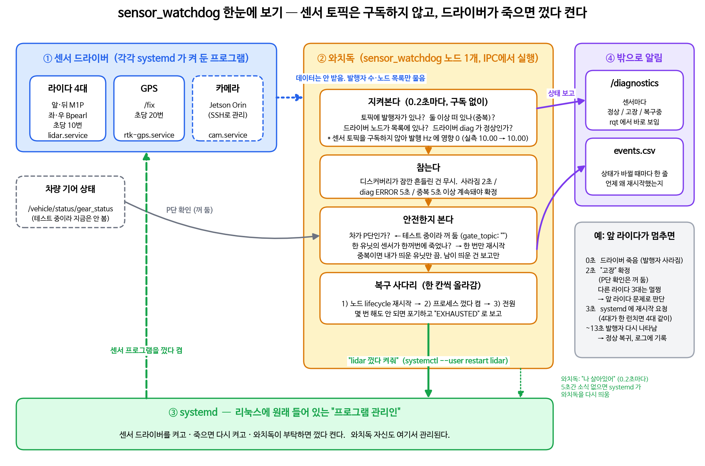

# sensor_watchdog

ROS 2 Humble 용 센서 감시·자동 복구 노드입니다. 라이다, GPS, 카메라 드라이버가 죽거나 사라지면 알아채고, 정해진 조건에서만 센서 프로세스를 껐다 켜며, 센서 상태를 `/diagnostics` 로 계속 알립니다.

**센서 토픽은 구독하지 않습니다.** 실차에서 구독자가 하나 더 붙으면 라이다 발행 주기가 떨어지는 현상이 있어서, 감시 근거를 DDS 그래프(발행자·노드 유무)와 드라이버가 내는 `/diagnostics` 로만 제한합니다. 와치독이 구독하는 토픽은 `/diagnostics` 하나뿐입니다.



- 센서 프로세스 관리는 리눅스 기본 관리자인 **systemd** 에 맡깁니다. 별도 셸 스크립트 없음.
- 와치독은 IPC 한 대에만 올립니다. 원격 장비(Jetson Orin 등)의 센서는 SSH 로 그 장비의 systemd 를 호출해 재시작합니다. 원격 장비엔 빌드가 필요 없습니다.
- 처음엔 **감지 전용 모드**(`dry_run: true`)로 돌려서 오탐이 얼마나 되는지 확인한 뒤에 실제 재시작을 켭니다.

> 상태: 판정 로직은 단위 테스트를 통과했고, ROS 2 Humble 에서 빌드·기동까지 확인했습니다. 설정은 실차 rosbag 기준으로 채웠지만 실차에서 실제 재시작은 아직 검증하지 않았습니다. 자세한 건 [검증 범위](#검증-범위와-한계) 참고.

---

## 목차

1. [무엇을 해결하나](#무엇을-해결하나)
2. [30초 요약: 어떻게 동작하나](#30초-요약-어떻게-동작하나)
3. [구성도](#구성도)
4. [파일 구조](#파일-구조)
5. [설치](#설치)
6. [매일 쓰는 명령](#매일-쓰는-명령)
7. [로그 읽는 법](#로그-읽는-법)
8. [동작 원리 자세히](#동작-원리-자세히)
9. [설정 레퍼런스](#설정-레퍼런스)
10. [실제 재시작을 켜기 전 절차](#실제-재시작을-켜기-전-절차)
11. [원격 장비를 SSH 로 재시작하기](#원격-장비를-ssh-로-재시작하기)
12. [안전 게이트 설정](#안전-게이트-설정)
13. [안전 MCU 하트비트](#안전-mcu-하트비트)
14. [자주 묻는 질문](#자주-묻는-질문)
15. [테스트](#테스트)
16. [검증 범위와 한계](#검증-범위와-한계)

---

## 무엇을 해결하나

실차에서 센서 드라이버는 가끔 죽습니다. 사람이 터미널을 보고 있다가 Ctrl+C 로 끄고 다시 켜는 건 주행 중엔 불가능합니다.

이 패키지는 그 일을 대신합니다. 단, 아무 때나 재시작하면 더 위험하기 때문에 다음 원칙을 지킵니다.

| 원칙 | 구현 |
|---|---|
| 센서 데이터 경로에 손대지 않는다 | 센서 토픽을 구독하지 않는다. DDS 디스커버리 정보(발행자 수, 노드 목록)와 드라이버 `/diagnostics` 만 본다. 실측: 와치독 유무에 따른 라이다 수신 Hz 차이 0 |
| 확실히 죽은 것만 건드린다 | 발행자가 사라졌거나, 노드가 사라졌거나, 드라이버 diag 보고가 끊긴 경우만 재시작. 드라이버가 스스로 ERROR 라고 보고하면 5초 더 지켜본 뒤 |
| 센서 탓이 아니면 건드리지 않는다 | 여러 복구 단위(유닛)가 동시에 죽으면 네트워크나 호스트 문제로 보고 재시작하지 않음 |
| 중복은 내가 띄운 것만 끈다 | 같은 토픽 발행자가 둘이면 `DUPLICATE`. 와치독이 직접 띄운 유닛이면 그 유닛만 `systemctl stop`. 남이 띄운 것은 보고만 |
| 재시작은 가벼운 것부터 | lifecycle 재활성화 → 서비스 재시작 → 전원 리셋 순서. 단계당 2회 |
| 무한 반복하지 않는다 | 사다리 끝까지 실패하면 `EXHAUSTED` 로 표시하고 사람을 기다림 |
| 다른 노드가 알 수 있어야 한다 | 상태를 표준 `/diagnostics` 토픽으로 1초마다 발행 |
| 감시하는 놈도 감시받는다 | systemd 가 5초마다 생존 확인. 작은 MCU 에 UDP 하트비트 |

**설계상 한계.** 발행자는 살아 있는데 데이터만 멈추는 고장은, 드라이버가 `/diagnostics` 를 내지 않으면 잡지 못합니다. 실차 백(bag1512)의 rslidar·GPS 드라이버는 diag 를 내지 않습니다. 그런 고장까지 잡으려면 드라이버에 `diagnostic_updater` 를 붙이고 `diag_names` 를 채웁니다.

---

## 30초 요약: 어떻게 동작하나

```
DDS 그래프 ──▶ 와치독 (0.2초마다 묻기. 구독 없음)
/diagnostics      │
                  ├─ 발행자 1개, 노드 있음, diag OK → /diagnostics 에 OK
                  │
                  ├─ 발행자 0개 / 노드 없음 / diag 끊김 → ERROR 보고, 2초 지속되면
                  │       "systemctl --user restart lidar" 실행
                  │        └─ systemd 가 런치 안의 모든 노드를 끄고 다시 켬. 10초 유예 후 다시 검사
                  │
                  └─ 발행자 2개 (중복) → 와치독이 띄운 유닛이면 "systemctl --user stop lidar"
                                        남이 띄운 거면 DUPLICATE_NOT_OURS 로 보고만
```

와치독은 센서를 직접 죽이지 않습니다. systemd 한테 "저거 껐다 켜줘" 하고 부탁만 합니다. 실제로 프로세스를 끄고 켜는 건 systemd 가 하고, 자식 프로세스까지 남김없이 정리합니다.

---

## 구성도

```
┌─────────────────────────────────────────────────────────────┐
│ IPC                                                         │
│                                                             │
│   systemd ─┬─ lidar.service     (ros2 launch ... 라이다)    │
│            ├─ rtk-gps.service   (ros2 launch ... GPS)       │
│            └─ sensor-watchdog.service  (ipc.yaml)           │
│                   ├─ 그래프 조회: 발행자 수·노드 목록 (구독 없음)│
│                   ├─ /diagnostics 구독 (드라이버 보고)         │
│                   ├─ /diagnostics 발행 ──────▶ 플래너        │
│                   ├─ 게이트 토픽 구독 (예: /ad_can/gear)      │
│                   ├─ UDP 하트비트 ───────────▶ 안전 MCU      │
│                   ├─ 라이다·GPS 재시작: systemctl --user ... │
│                   └─ 카메라 재시작: ssh orin systemctl ... ──┐
└──────────────────────────────────────────────────────────────┼──┘
                                                               │
┌──────────────────────────────────────────────────────────────▼──┐
│ Orin  (빌드 불필요. 서비스 파일 하나와 SSH 키 등록만)            │
│                                                                 │
│   systemd ─── cam.service       (ros2 launch ... 카메라)        │
└─────────────────────────────────────────────────────────────────┘
```

와치독은 IPC 에 하나만 돕니다. 카메라 토픽은 DDS 로 IPC 에서 보이니까 감시는 그대로 되고, 재시작할 때만 SSH 로 Orin 의 systemd 를 호출합니다. 차량 내부 이더넷 스위치처럼 안정적인 망을 전제로 한 구성입니다.

Orin 에도 와치독을 따로 올리고 싶다면(망이 불안정하거나 SSH 키를 두기 싫을 때) `config/orin.yaml` 을 쓰면 됩니다. [자주 묻는 질문](#자주-묻는-질문) 참고.

---

## 파일 구조

```
sensor_watchdog/
├── include/sensor_watchdog/
│   ├── health.hpp          판정 로직(그래프·diag) + 복구 사다리 + 공통 원인 판정 (ROS 의존 없음)
│   └── cdr_header.hpp      게이트 토픽의 첫 정수 필드만 읽기
├── src/watchdog.cpp        ROS 노드. 그래프 조회, /diagnostics 구독·발행, systemctl 호출, 기록
├── test/
│   ├── test_health.cpp     ROS 없이 돌아가는 단위 테스트
│   ├── bag_fault_test.py   실차 로스백으로 13개 고장 시나리오 자동 테스트
│   └── test_bag_diag_check.py
├── config/
│   ├── ipc.yaml            IPC 용. 실차 bag 기준 라이다 4대 + GPS (+ 카메라 자리). 기본 구성
│   └── orin.yaml           Orin 에 와치독을 따로 올릴 때만
├── systemd/
│   ├── lidar.service       센서 런치를 systemd 서비스로
│   ├── rtk-gps.service
│   ├── cam.service
│   └── sensor-watchdog.service
├── scripts/
│   ├── watchdog_on.sh      와치독 켜기 (유닛이 있으면 유닛, 없으면 직접 실행)
│   ├── watchdog_off.sh     와치독 끄기
│   ├── bag_diag_check.py   백에서 "diag 만 봐도 잡혔을까" 대조
│   ├── hz_ab_test.py       구독자 하나 더 붙을 때 Hz 영향 A/B 측정
│   ├── env.bash.example    서비스가 source 할 ROS 환경 파일 틀
│   └── power_cycle.sh.example   전원 리셋 스크립트 틀 (수단이 있을 때만)
├── CMakeLists.txt
└── package.xml
```

---

## 설치

### 0. 준비물

- Ubuntu 22.04 + ROS 2 Humble
- 센서 드라이버가 이미 `ros2 launch` 로 돌아가는 상태
- 감시할 토픽 이름과 타입. 모르면 센서 켠 상태에서:

```bash
ros2 topic list -t                        # 토픽 이름과 타입
ros2 topic info /토픽이름 --verbose       # QoS (Reliability, Durability)
ros2 topic hz /토픽이름                   # 주기
```

### 1. 빌드 (IPC 에서만)

```bash
sudo apt install -y build-essential python3-colcon-common-extensions \
  ros-humble-rclcpp ros-humble-diagnostic-msgs ros-humble-lifecycle-msgs \
  ros-humble-sensor-msgs coreutils

mkdir -p ~/watchdog_ws/src
cd ~/watchdog_ws/src
git clone https://github.com/utsi09/sensor_watchdog.git
cd ~/watchdog_ws

source /opt/ros/humble/setup.bash
colcon build --symlink-install --packages-select sensor_watchdog
colcon test --packages-select sensor_watchdog && colcon test-result --verbose
```

### 2. 설정 파일 복사

```bash
mkdir -p ~/.config/sensor_watchdog ~/.config/systemd/user
cd ~/watchdog_ws/src/sensor_watchdog

cp scripts/env.bash.example ~/.config/sensor_watchdog/env.bash
cp config/ipc.yaml          ~/.config/sensor_watchdog/watchdog.yaml
cp systemd/lidar.service systemd/rtk-gps.service systemd/sensor-watchdog.service ~/.config/systemd/user/
```

### 3. 빈칸 채우기 (세 파일)

**`~/.config/sensor_watchdog/env.bash`** — 센서 켤 때 필요한 환경. `.bashrc` 전체를 넣지 말고 필요한 줄만.

```bash
source /opt/ros/humble/setup.bash
source /home/nvidia/ros2_ws/install/setup.bash    # 드라이버 워크스페이스
export ROS_DOMAIN_ID=101                           # 실차 도메인. 와치독과 센서 유닛 모두 이 파일을 읽으므로 같은 값이 된다
# export RMW_IMPLEMENTATION=rmw_cyclonedds_cpp
```

**`~/.config/sensor_watchdog/watchdog.yaml`** — `config/ipc.yaml` 은 실차 bag(bag1512) 기준으로 라이다 4대(`/front_m1p`, `/rear_m1p`, `/left_bp`, `/right_bp` 의 `rslidar_points`), GPS(`/fix`), 게이트 설정이 채워져 있습니다. 단, 테스트 중이라 `gate_topic` 은 `""` 로 비워 두어 기어와 무관하게 재시작합니다. 상용화 전에 `/vehicle/status/gear_status` 로 되돌리면 P단에서만 재시작합니다. 남은 `CHANGE_ME` 는 카메라 토픽 하나이며, 카메라는 확인 전까지 `sensors` 목록에서 빠져 있습니다.

```yaml
front_m1p:
  topic: /front_m1p/rslidar_points       # bag 에서 확인한 이름. 발행자 수만 센다 (구독 안 함, 타입 불필요)
  node_name: ""                          # ros2 node list 로 확인해 채우면 노드 사라짐·중복도 잡는다
  unit: lidar.service                    # 네 대가 한 런치면 모두 같은 유닛
  # diag_names: ["rslidar"]              # 드라이버가 /diagnostics 를 내면 그 이름 조각 (rslidar_sdk 는 안 냄)
```

같은 `unit` 을 쓰는 센서는 하나의 **복구 단위**로 묶입니다. 어느 한 대가 끊겨 유닛을 재시작하면 나머지는 유예(GRACE)로 들어가고 같은 틱에 중복 재시작하지 않습니다.

**`~/.config/systemd/user/lidar.service`** — `ExecStart` 에 평소 치던 런치 명령.

```ini
ExecStart=/bin/bash -c 'source %h/.config/sensor_watchdog/env.bash && exec ros2 launch velodyne_driver velodyne_driver_node-VLP16-launch.py'
```

평소 alias 로 켰다면 `alias lidar` 를 치면 실제 명령이 나옵니다. 그걸 그대로 넣으면 됩니다.

### 4. systemd 에 알리기, 기존 센서 끄기

```bash
systemctl --user daemon-reload
```

터미널에서 띄워둔 센서가 있으면 Ctrl+C 로 전부 끕니다. 안 끄면 두 개가 동시에 돌아갑니다.

### 5. 켜기

```bash
systemctl --user start lidar rtk-gps          # 센서
systemctl --user start sensor-watchdog        # 와치독 (감지 전용 모드)
journalctl --user -u sensor-watchdog -f       # 로그 보기
```

`[lidar] HEALTHY` 가 뜨면 성공입니다.

### 6. (선택) 부팅 시 자동 시작

```bash
loginctl enable-linger $USER                  # 로그인 안 해도 user 서비스 유지. 한 번만
systemctl --user enable lidar rtk-gps sensor-watchdog
```

자동 시작이 싫으면 `enable` 을 하지 않고 매번 `start` 만 쓰면 됩니다.

### 7. Orin 쪽 준비 (빌드 없음)

Orin 에는 카메라 서비스 파일과 환경 파일만 둡니다.

```bash
# Orin 에서
mkdir -p ~/.config/sensor_watchdog ~/.config/systemd/user
# env.bash 와 cam.service 를 IPC 에서 scp 로 복사하거나 직접 작성
nano ~/.config/sensor_watchdog/env.bash       # Orin 의 ROS·카메라 워크스페이스 환경
nano ~/.config/systemd/user/cam.service       # ExecStart 에 카메라 런치 명령
systemctl --user daemon-reload
loginctl enable-linger $USER                  # SSH 로 systemctl --user 를 쓰려면 필수
systemctl --user start cam
```

그다음 IPC 에서 Orin 으로 SSH 가 비밀번호 없이 되게 합니다. [원격 장비를 SSH 로 재시작하기](#원격-장비를-ssh-로-재시작하기) 참고.

---

## 원격 장비를 SSH 로 재시작하기

IPC 의 와치독이 카메라 재시작을 위해 실행하는 명령은 이것입니다 (`ipc.yaml` 의 `camera.systemctl_cmd`).

```
ssh -o BatchMode=yes -o ConnectTimeout=3 orin systemctl --user restart cam.service
```

이게 사람 개입 없이 되려면 세 가지가 필요합니다.

### 1. IPC 의 SSH 설정에 별칭 등록

```bash
# IPC 에서
mkdir -p ~/.ssh && chmod 700 ~/.ssh
cat >> ~/.ssh/config <<'EOF'
Host orin
    HostName ORIN_IP          # Orin 주소
    User ORIN_USER                  # Orin 계정
    IdentityFile ~/.ssh/id_watchdog
EOF
```

### 2. 전용 키 만들고 Orin 에 등록

```bash
# IPC 에서. 암호구문 없이 (자동 실행용)
ssh-keygen -t ed25519 -f ~/.ssh/id_watchdog -N "" -C "watchdog@ipc"
ssh-copy-id -i ~/.ssh/id_watchdog.pub orin
ssh -o BatchMode=yes orin 'echo SSH_OK'      # SSH_OK 가 나와야 함
```

### 3. Orin 에서 그 키의 권한을 재시작 명령 하나로 제한

암호 없는 키는 그 자체로 Orin 쉘을 여는 열쇠입니다. 이 키로는 카메라 재시작밖에 못 하게 묶어 둡니다. Orin 의 `~/.ssh/authorized_keys` 에서 방금 등록된 줄(`watchdog@ipc` 로 끝나는 줄) 맨 앞에 다음을 붙입니다.

```
command="systemctl --user restart cam.service",no-pty,no-port-forwarding,no-agent-forwarding,no-X11-forwarding ssh-ed25519 AAAA... watchdog@ipc
```

이렇게 하면 IPC 가 어떤 명령을 보내든 Orin 은 `systemctl --user restart cam.service` 만 실행합니다. 확인:

```bash
# IPC 에서
ssh -o BatchMode=yes orin 'ls'               # ls 가 아니라 재시작이 실행돼야 정상
ssh -o BatchMode=yes orin 'whoami'           # 역시 재시작만 됨
```

### 알아둘 것

- Orin 이 재설치되면 호스트 키가 바뀌어 SSH 가 조용히 실패합니다. 와치독 로그에 `action done exit=255` 가 반복되면 이 경우입니다. IPC 에서 `ssh-keygen -R ORIN_IP` 후 다시 접속해 호스트 키를 받으면 됩니다.
- IPC ↔ Orin 망이 끊기면 카메라 토픽도 끊기고 SSH 도 안 됩니다. 와치독은 카메라 고장으로 보고 재시작을 시도하다 실패하고, 라이다·GPS 가 함께 끊기면 `BLOCKED_COMMON_CAUSE` 로 멈춥니다.
- SSH 가 걸리는 시간만큼 복구가 늦어집니다. `ConnectTimeout=3` 이라 최악 3초 추가입니다.

---

## 매일 쓰는 명령

| 하고 싶은 것 | 명령 |
|---|---|
| 와치독 켜기 | `scripts/watchdog_on.sh` (유닛이 있으면 `systemctl --user start sensor-watchdog`, 없으면 직접 띄움. `--live` 면 dry_run 끔) |
| 와치독 끄기 | `scripts/watchdog_off.sh` |
| 센서 켜기 | `systemctl --user start lidar` |
| 센서 끄기 | `systemctl --user stop sensor-watchdog` 먼저, 그다음 `systemctl --user stop lidar` |
| 카메라 켜고 끄기 | Orin 에서 `systemctl --user start cam` / `stop cam` |
| 센서 껐다 켜기 | `systemctl --user restart lidar` |
| 살아 있나 | `systemctl --user status lidar` |
| 센서 로그 | `journalctl --user -u lidar -f` |
| 와치독 로그 | `journalctl --user -u sensor-watchdog -f` |
| 상태 토픽 | `ros2 topic echo /diagnostics` |
| 사건 기록 | `tail -f ~/.local/state/sensor_watchdog/events.csv` |

**끄는 순서 주의.** 와치독이 켜진 채로 센서만 끄면, 와치독이 "발행자가 사라졌다"고 보고 2초 뒤 다시 켭니다.

---

## 로그 읽는 법

`journalctl --user -u sensor-watchdog -f` 에 나오는 줄의 뜻:

| 로그 | 뜻 | 할 일 |
|---|---|---|
| `[lidar] GRACE` | 시작 직후 10초 유예. 아직 판정 안 함 | 기다림 |
| `[lidar] HEALTHY` | 정상 | 없음 |
| `[lidar] HOLDING: NO_PUBLISHER` | 발행자가 사라짐. 2초 더 지켜보는 중 | 보통 디스커버리 흔들림이면 혼자 돌아옴 |
| `[lidar] COOLDOWN: NO_PUBLISHER` | 고장인데 직전 재시작 후 30초 안 지남 | 기다림 |
| `[lidar] MONITOR_ONLY: DIAG_ERROR` | 고장이지만 재시작 대상 아님 (설정에서 뺀 경우) | 로그만 확인 |
| `[lidar] DUPLICATE_NOT_OURS: DUPLICATE` | 발행자가 둘인데 와치독이 띄운 게 아님 | 누가 따로 띄웠는지 확인해서 손으로 정리 |
| `[lidar] DUPLICATE: 2 publishers on ...; stopping the unit we started` | 와치독이 띄운 유닛이 중복의 한쪽. 그 유닛을 끄는 중 | 남은 쪽이 정상인지 확인 |
| `[lidar] BLOCKED_COMMON_CAUSE` | 여러 복구 단위(유닛)가 동시에 죽음. 센서 탓 아님 | 네트워크·호스트 확인 |
| `[rear_m1p] WAIT_SHARED_ACTION` | 같은 유닛을 다른 센서가 이미 재시작 중 | 기다리면 됨 |
| `[lidar] BLOCKED_GATE` | 차량 쪽이 재시작 허가 안 함 | 정차 후 자동 진행 |
| `[lidar] DRY_RUN_WOULD_service` | 감지 전용 모드. "원래면 지금 재시작했다" | 오탐인지 확인 |
| `[lidar] ACTION restart lidar.service (step 1, attempt 1, total 1)` | 실제 재시작 중 | 10초 뒤 결과 확인 |
| `[lidar] action done exit=0; re-checking after grace` | 명령 끝남. 성공 여부는 다음 판정에서 | |
| `[lidar] EXHAUSTED: NO_PUBLISHER — human needed` | 사다리 끝까지 실패 | 직접 확인 |

고장 코드 전체:

| 코드 | 뜻 | 근거 | 재시작 대상 (기본) |
|---|---|---|---|
| `NODE_NOT_VISIBLE` | 설정한 노드 이름이 그래프에 없음 (프로세스 죽음) | 그래프 | O (2초) |
| `NO_PUBLISHER` | 토픽 발행자가 0개 (프로세스 죽음 또는 아직 안 뜸) | 그래프 | O (2초) |
| `DIAG_STALE` | 드라이버 diag 보고가 `diag_timeout_sec` 넘게 끊김 (프로세스는 있는데 멈춤) | `/diagnostics` | O (2초) |
| `DIAG_ERROR` | 드라이버 diag 가 ERROR (드라이버 스스로 고장을 보고) | `/diagnostics` | O (5초 지속 시) |
| `DUPLICATE` | 발행자가 `max_publishers` 보다 많거나 같은 이름 노드가 둘 이상 | 그래프 | 재시작 아님. 와치독이 띄운 유닛이면 그 유닛만 stop |

---

## 동작 원리 자세히

### 1. 묻기: 구독하지 않고 그래프를 본다

와치독은 센서 토픽을 구독하지 않습니다. 0.2초마다 ROS 그래프 API 로 두 가지를 묻습니다.

- `count_publishers(topic)`: 이 토픽에 발행자가 몇 개인가 (DDS 디스커버리 정보. 데이터 경로와 무관)
- `get_node_names()`: 설정한 `node_name` 이 몇 번 나오는가 (`node_name` 을 채운 센서만)

둘 다 로컬 디스커버리 캐시를 읽는 것이라 발행자에게는 아무 영향이 없습니다. 실차 백으로 와치독 없이/있이 수신 Hz 를 비교하면 라이다 4대 10.00 → 10.00 Hz, GPS 19.99 → 19.99 Hz 로 차이가 없고, 센서 토픽 구독자 수도 늘지 않습니다(`hz_impact` 테스트).

드라이버가 `/diagnostics` 를 낸다면(diagnostic_updater 를 쓰는 드라이버: velodyne, ouster, ublox 등) `diag_names` 에 그 status 이름 조각을 적습니다. 그러면 와치독이 `/diagnostics` 하나를 구독해서 그 센서의 보고 level 과 보고 간격을 봅니다. 이건 수십 바이트짜리 1 Hz 토픽이라 부하가 없습니다.

### 2. 판정: 0.2초마다 네 가지 검사

```
1. 노드가 그래프에 있나?            (node_name 설정 시)        없으면 NODE_NOT_VISIBLE
2. 발행자가 있나?                                              0개면 NO_PUBLISHER
---- 여기부터는 해당되는 것 전부 ----
3. 발행자(또는 노드)가 둘 이상인가?                             DUPLICATE
4. 드라이버 diag 가 정상인가?        (diag_names 설정 시)       보고 끊김 DIAG_STALE / ERROR 면 DIAG_ERROR
→ 전부 통과하면 HEALTHY
```

1, 2 는 "데이터 출처가 없다"는 뜻이라 걸리면 그것 하나만 보고합니다. 발행자가 있으면 3, 4 를 모두 검사해서 `faults` 에 `A+B` 꼴로 전부 싣고, 재시작 여부는 그중 **하나라도** 행동 대상이면 결정됩니다(OR).

### 3. "죽었다"의 정의

```
발행자 사라짐
  ↓ 즉시                          NO_PUBLISHER 판정. /diagnostics 에 ERROR
  ↓ 2.0초 (fault_hold_sec)        고장이 계속되면
  = 2.0초                         재시작
```

중간에 발행자가 돌아오면 처음부터 다시 셉니다. DDS 디스커버리가 잠깐 흔들려 0.5초 사라졌다 돌아오는 경우는 `HOLDING` 만 거치고 행동하지 않습니다(`flap` 테스트).

주의할 점: 드라이버가 강제로 죽거나(SIGKILL) 호스트가 멈추면 DDS 가 발행자 소멸을 알아채는 데 수 초~수십 초가 걸릴 수 있습니다(참여자 liveliness lease). 정상 종료(SIGINT)는 즉시 알려집니다. 그 사이는 `diag_names` 가 있는 센서만 `DIAG_STALE` 로 먼저 잡습니다.

### 4. 재시작 전 세 가지 관문

`ACT` 판정이 나도 바로 재시작하지 않습니다.

1. **고장 종류가 행동 대상인가.** 확실한 고장(`act_on_faults`: 노드 없음, 발행자 없음, diag 끊김)은 2초, 드라이버 자체 보고(`act_on_faults_slow`: DIAG_ERROR)는 5초 지속돼야 행동. 둘 다 아니면 `MONITOR_ONLY`. `DUPLICATE` 는 재시작 대상이 아니라 별도 처리(아래 5-1).
2. **공통 원인이 아닌가.** `common_cause_window_sec`(3초) 안에 `common_cause_min`(기본 2개) 이상의 **복구 단위**(systemd 유닛)가 함께 죽었으면 `BLOCKED_COMMON_CAUSE`. 센서 수가 아니라 유닛 수로 셉니다. 라이다 4대가 `lidar.service` 하나에서 돌면 넷이 같이 죽어도 1개로 셉니다. 그건 그 유닛의 고장이지 공통 원인이 아니기 때문입니다. 반대로 라이다 유닛과 GPS 유닛이 같이 죽으면 IPC·DDS·네트워크 문제로 보고 재시작하지 않습니다.
3. **같은 유닛을 다른 센서가 이미 재시작 중이 아닌가.** 진행 중이면 `WAIT_SHARED_ACTION` 으로 기다립니다. 재시작이 끝나면 그 유닛의 모든 센서가 함께 유예(GRACE)를 받습니다.
4. **안전 게이트가 허용했는가.** (지금 설정은 `gate_topic: ""` 라 이 관문은 항상 통과) `gate_topic` 을 설정하면 그 값(예: 기어 P)이 맞을 때만 재시작하고, 아니면 `BLOCKED_GATE` 로 기다립니다. 주행 중에 라이다 유닛을 껐다 켜면 멀쩡한 라이다 3대까지 10초 넘게 사라지기 때문입니다. 주행 중이라도 일정 시간 지나면 재시작하게 하려면 `gate_bypass_after_sec` 에 초를 줍니다(기본 -1.0 = 항상 게이트 따름. YAML 에서는 소수점을 붙여야 double 로 읽힘).
5. **`dry_run` 이 꺼져 있는가.** 켜져 있으면 `DRY_RUN_WOULD_*` 만 기록.

#### 5-1. 중복 노드 처리

같은 토픽에 발행자가 둘이거나 같은 이름 노드가 둘이면 `DUPLICATE` 입니다. 흔한 원인은 "재시작했는데 옛 프로세스가 안 죽었다" 또는 "사람이 터미널에서 또 띄웠다" 입니다.

- 와치독이 그 유닛을 직접 띄운 적이 있으면(`started_by_watchdog: true`. service/power 행동이 끝난 뒤부터) `duplicate_hold_sec`(5초) 지속 시 **그 유닛만** `systemctl --user stop <unit>` 합니다. systemd 는 그 유닛이 띄운 프로세스만 알고 있어서(cgroup) 사람이 따로 띄운 쪽은 건드리지 않습니다. 상태는 `STOPPING_DUPLICATE`, 사다리 시도 횟수는 올라가지 않습니다.
- 와치독이 띄운 적이 없으면 `DUPLICATE_NOT_OURS` 로 보고만 합니다. 아무것도 끄지 않습니다.
- 재시작 직후에는 옛 발행자가 디스커버리에서 빠지기까지 몇 초 동안 둘로 보일 수 있어 유예 10초 + 5초 지속 조건을 둡니다.

### 5. 복구 사다리

```
lifecycle  →  service  →  power  →  EXHAUSTED
(ms 단위)     (초 단위)    (수십 초)   (사람 호출)
```

- **lifecycle**: 드라이버가 ROS 2 lifecycle 노드일 때만. 프로세스는 그대로 두고 `deactivate → activate`. 가장 빠름. `lifecycle_node` 설정 시에만 사다리에 포함.
- **service**: `systemctl --user restart <unit>`. 프로세스를 끄고 다시 켬. `unit` 설정 시에만.
- **power**: `power_cmd` 로 지정한 스크립트 실행. PoE 포트 off/on, USB 허브 리셋 등 센서 장치 전원만 껐다 켬. IPC 나 Orin 을 재부팅하는 게 아님. `power_cmd` 설정 시에만.

같은 칸을 `attempts_per_step`(2회) 시도해도 안 되면 다음 칸. 끝까지 실패하면 `EXHAUSTED`. `healthy_reset_sec`(10분) 동안 정상이면 사다리를 처음으로 되돌립니다.

각 행동 뒤에는 `startup_grace_sec`(10초) 유예 후 다시 판정하고, `cooldown_sec`(30초) 동안은 다음 행동을 하지 않습니다.

### 6. 상태 발행: `/diagnostics`

1초마다 `diagnostic_msgs/DiagnosticArray` 를 발행합니다. 센서마다 하나, 그리고 요약 하나.

```
name: "watchdog_ipc: lidar"
level: 0=OK, 1=WARN(유예 중), 2=ERROR(고장)
message: "HOLDING: NO_PUBLISHER"
values: fault, faults, state, publishers, node(unchecked/visible/missing/duplicate xN), started_by_watchdog,
        diag_level, diag_age_sec, diag_count, diag_message (diag_names 설정 시), step, attempts_at_step, total_actions, exhausted, dry_run
요약(summary) values: gate, sensor_topic_subscriptions(항상 0)
```

플래너는 `level` 만 보면 됩니다. `ERROR` 면 그 센서를 지금 쓰면 안 됩니다.

### 7. 기록

`log_dir` 아래 `events.csv` 하나. 상태 변화, 행동 시작·종료, 복구까지 걸린 시간, 중복 정리, 게이트 우회. `log_max_mb`(기본 20 MB)를 넘으면 `.1` 백업 하나만 남기고 새로 시작합니다. 메시지별 원시 로그는 없습니다(구독을 안 하니까).

### 8. 와치독 자체 감시

- systemd `WatchdogSec=5`: 와치독이 0.2초마다 `WATCHDOG=1` 을 보냅니다. 5초 끊기면 systemd 가 죽이고 다시 띄웁니다.
- UDP 하트비트: `heartbeat_host` 를 설정하면 0.2초마다 MCU 에 한 줄 보냅니다. MCU 는 끊기면 IPC 에 묻지 않고 스스로 안전 정지합니다. [규약](#안전-mcu-하트비트) 참고.

---

## 설정 레퍼런스

`config/ipc.yaml` 기준. 모든 값은 ROS 파라미터라 `--ros-args -p dry_run:=false` 처럼 명령줄에서 덮어쓸 수 있습니다.

### 전역

| 키 | 기본값 | 뜻 |
|---|---|---|
| `dry_run` | `true` | true 면 판정·기록만 하고 행동 안 함 |
| `log_dir` | `~/.local/state/sensor_watchdog` | `events.csv` 위치. `""` 면 끔 (구 이름 `raw_log_dir` 도 받음) |
| `log_max_mb` | `20.0` | `events.csv` 크기 상한. 넘으면 `.1` 백업 하나만 남기고 새로 시작. `0` 이면 무제한 |
| `gate_topic` | `""` | 재시작 허가 토픽. `""` 면 항상 허용. 켜면 그 토픽 하나를 구독한다(기어 상태 같은 작은 토픽) |
| `gate_type` | `std_msgs/msg/Bool` | 게이트 토픽 타입 |
| `gate_prefix` | `none` | 첫 정수 필드 앞에 오는 것. `none`(바로 정수), `stamp`(`builtin_interfaces/Time` 하나), `header`(`std_msgs/Header`). autoware `GearReport` 는 `stamp` |
| `gate_has_header` | `false` | (구버전 호환) `gate_prefix` 가 없을 때만 쓰임. `true` 면 `header` |
| `gate_field_bytes` | `1` | prefix 다음 첫 필드 크기 (1, 2, 4, 8) |
| `gate_ok_value` | `1` | 이 값이면 허용 |
| `gate_reliable` | `true` | 게이트 구독 QoS |
| `gate_timeout_sec` | `1.0` | 이 시간 안에 게이트 메시지가 와야 유효 |
| `gate_bypass_after_sec` | `-1.0` | 음수면 항상 게이트 따름. 양수면 고장이 이만큼 지속될 때 게이트 무시 |
| `common_cause_min` | `3` (ipc.yaml 은 `2`) | 이 개수 이상의 복구 단위(유닛)가 동시 고장이면 공통 원인. 유닛 수와 같게 두면 "전부 죽었을 때만" |
| `common_cause_window_sec` | `3.0` | "동시"의 기준 |
| `action_timeout_sec` | `30.0` | 한 행동에 허용하는 최대 시간 |
| `systemctl_cmd` | `["systemctl", "--user"]` | 서비스 재시작 명령 앞부분. 시스템 유닛이면 `["sudo", "-n", "systemctl"]` |
| `heartbeat_host` | `""` | MCU IPv4 주소. `""` 면 끔 |
| `heartbeat_port` | `5005` | |
| `startup_grace_sec` | `10.0` | 시작·행동 직후 판정 유예 |
| `fault_hold_sec` | `2.0` | 고장이 이만큼 지속돼야 행동 |
| `act_on_faults` | `[NODE_NOT_VISIBLE, NO_PUBLISHER, DIAG_STALE]` | 확실한 고장. `fault_hold_sec` 뒤 행동 |
| `act_on_faults_slow` | `[DIAG_ERROR]` | 드라이버 자체 보고. `slow_fault_hold_sec` 뒤 행동 |
| `slow_fault_hold_sec` | `5.0` | |
| `duplicate_hold_sec` | `5.0` | `DUPLICATE` 가 이만큼 지속되면, 와치독이 띄운 유닛이면 끈다 |
| `cooldown_sec` | `30.0` | 행동 완료 후 다음 행동까지 최소 간격 |
| `attempts_per_step` | `2` | 같은 칸 시도 횟수 |
| `healthy_reset_sec` | `600.0` | 이만큼 정상이면 사다리 초기화 |
| `ladder` | `[service]` (설정 파일은 `[lifecycle, service]`) | 복구 순서 |
| `sensors` | | 감시할 센서 id 목록 |

### 센서별 (`<id>.` 아래)

| 키 | 기본값 | 뜻 |
|---|---|---|
| `topic` | 필수 | `/` 로 시작. 발행자 수를 세는 데만 쓴다 (구독하지 않음). 타입은 필요 없다 |
| `node_name` | `""` | 설정하면 노드 존재·중복 검사. `/` 로 시작. `ros2 node list` 로 확인 |
| `max_publishers` | `1` | 이보다 발행자가 많으면 `DUPLICATE` |
| `diag_names` | 없음 | `/diagnostics` 에서 이 센서로 볼 status 이름 조각 목록. 설정하면 `DIAG_STALE`/`DIAG_ERROR` 검사. 빈 리스트 `[]` 는 쓰지 말고 줄을 지울 것 |
| `diag_timeout_sec` | `3.0` | diag 보고가 이 시간 넘게 없으면 `DIAG_STALE` |
| `diag_error_level` | `2` | 이 level 이상이면 `DIAG_ERROR` (1 WARN, 2 ERROR, 3 STALE) |
| `lifecycle_node` | `""` | lifecycle 노드 이름. 설정 시 사다리에 lifecycle 칸 포함 |
| `unit` | `""` | systemd 유닛 이름. 설정 시 service 칸 포함 |
| `power_cmd` | 없음 | 전원 리셋 명령 배열. 설정 시 power 칸 포함. 빈 배열 `[]` 은 쓰지 말고 줄을 지울 것 |
| `systemctl_cmd` | 없음 | 이 센서만 쓸 재시작 명령 앞부분. 원격 장비면 `["ssh", "-o", "BatchMode=yes", "-o", "ConnectTimeout=3", "orin", "systemctl", "--user"]`. 없으면 전역 값 |

---

## 실제 재시작을 켜기 전 절차

이 숫자들(2초, 10초)은 전부 예시입니다. 실제 센서에 맞는 값은 측정해서 정해야 합니다.

### 1. 예상값을 먼저 적는다

| 센서 | 재시작 후 발행자가 다시 뜨기까지 (초) | 하루 죽는 횟수 예상 | 근거 |
|---|---|---|---|
| lidar | | | |
| gps | | | |
| camera | | | |

적어두고 나중에 `events.csv` 와 비교합니다. 맞으면 설정값에 근거가 생기고, 틀리면 뭘 몰랐는지 알게 됩니다.

bag1512 재생으로 이미 실측한 값은 다음과 같습니다. 와치독은 이 주기를 재지 않지만(구독 안 함), 드라이버 diag 를 붙일 때 기준이 됩니다.

| 센서 | 토픽 | 실측 주기 | 최대 간격 | 메시지 크기 |
|---|---|---|---|---|
| front_m1p, rear_m1p | `/*_m1p/rslidar_points` | 10.03 Hz | 100 ms | 1,260,156 B 고정 |
| left_bp, right_bp | `/*_bp/rslidar_points` | 10.03 Hz | 100 ms | 921,75x B 고정 |
| gps | `/fix` | 20.05 Hz | 100 ms | 128 B 고정 |

### 2. 기본 동작을 실측한다 (각 5분, 스톱워치)

1. `systemctl --user restart lidar` 후 `ros2 topic hz` 가 다시 뜨기까지 몇 초인가 → `startup_grace_sec` 근거
2. 라이다 케이블을 뽑았다 꽂으면 드라이버가 혼자 살아나는가. 산다면 재시작이 필요 없는 고장이다 → `fault_hold_sec` 근거
3. `systemctl --user stop lidar` 후 `pgrep -af <드라이버패키지>` 에 남는 프로세스가 있는가 → `KillMode` 검증

### 3. 감지 전용 운행

`dry_run: true` 로 며칠 운행합니다. `events.csv` 의 `DRY_RUN_WOULD_*` 줄을 하나씩 보고 "진짜 고장이었나, 오탐이었나"를 적습니다.

### 4. 활성화 기준

아래를 모두 만족하면 `dry_run: false` 로 바꿉니다.

- 진짜 고장이 10회 이상 관측됐다
- 오탐이 진짜 고장의 절반 이하다
- 예상값 표와 `events.csv` 의 복구 시간이 일치했다. 불일치했다면 원인을 기록했다
- 플래너가 `/diagnostics` ERROR 를 받으면 감속·정지하는 것을 정지 상태에서 확인했다

```bash
# watchdog.yaml 에서 dry_run: false 로 바꾼 뒤
systemctl --user restart sensor-watchdog
```

---

## 안전 게이트 설정

차량 쪽 코드를 고치지 않고 기존 토픽을 그대로 씁니다. 실차에서는 autoware 의 기어 상태를 씁니다.

```bash
ros2 topic type /vehicle/status/gear_status            # autoware_vehicle_msgs/msg/GearReport
ros2 interface show autoware_vehicle_msgs/msg/GearReport
#   builtin_interfaces/Time stamp     ← std_msgs/Header 가 아니라 stamp 만 있음 → gate_prefix: stamp
#   uint8 report                      ← PARK = 22
ros2 topic echo /vehicle/status/gear_status --once     # 실제 값
```

```yaml
gate_topic: /vehicle/status/gear_status
gate_type: autoware_vehicle_msgs/msg/GearReport
gate_prefix: stamp            # none: 바로 정수 / stamp: Time 하나 뒤 / header: std_msgs/Header 뒤
gate_field_bytes: 1           # report 가 uint8
gate_ok_value: 22             # PARK
gate_reliable: true           # ros2 topic info --verbose 의 Reliability 와 맞춤
```

`gate_prefix` 를 잘못 주면 증상이 이렇습니다.

| 설정 | 결과 |
|---|---|
| `stamp` (정답) | `allowed value=22` |
| `none` | stamp 의 첫 바이트를 읽어 엉뚱한 값. 거의 항상 `blocked` |
| `header` | report 값을 frame_id 길이로 읽어 파싱 실패. `no message (blocked)` 처럼 보임 |

제약: 기어 값이 (prefix 를 제외하고) 메시지의 **첫 번째 필드**여야 합니다. 다른 위치면 `include/sensor_watchdog/cdr_header.hpp` 의 `read_first_int` 를 그 타입에 맞게 바꿔야 합니다.

게이트 판정 결과는 `/diagnostics` 요약 항목의 `gate` 값에서 볼 수 있습니다 (`allowed value=22`, `blocked value=2`, `no message (blocked)`).

---

## 안전 MCU 하트비트

`heartbeat_host` 를 설정하면 0.2초마다 UDP 로 한 줄을 보냅니다.

```
WD <틱번호> <정상수>/<센서수> <최악레벨>\n
예) WD 1234 2/2 0
```

최악레벨: `0` 모두 정상, `1` 유예 중인 센서 있음, `2` 고장 센서 있음.

MCU 쪽 규칙 (펌웨어는 이 패키지 범위 밖):

- 1초 이상 패킷이 없으면 → IPC 또는 와치독이 죽은 것. 안전 정지
- 레벨 2가 N초 이상 지속되면 → 안전 정지

MCU 는 IPC 에 묻지 않고 스스로 판단합니다. 지키는 쪽이 지켜지는 쪽 위에 살면 안 되기 때문입니다.

---

## 자주 묻는 질문

**systemd 가 뭔가요?**
리눅스에 기본으로 들어 있는 프로그램 관리자입니다. 부팅할 때 네트워크, SSH 등을 띄우는 게 systemd 입니다. 이 패키지는 센서 런치를 systemd 서비스로 등록해서 켜고 끄고, 죽으면 되살리고, 재시작할 때 자식 프로세스까지 정리하는 일을 systemd 에 맡깁니다. 와치독이 하는 "재시작"은 `systemctl --user restart lidar` 한 줄입니다.

**systemd 와 와치독이 둘 다 재시작하면 충돌하지 않나요?**
드라이버가 아예 죽으면(세그폴트) systemd 가 `Restart=on-failure` 로 3초 뒤 되살립니다. 와치독도 3초쯤 `restart` 를 보내지만 같은 유닛이라 한 번만 뜹니다. 드라이버가 살아 있는데 데이터만 안 나오는 경우(행)는 systemd 가 모르고 와치독만 잡습니다. 역할이 나뉩니다.

**부팅 시 자동으로 안 띄우고 싶어요.**
`enable` 을 하지 않고 `start` 만 쓰면 됩니다. 이미 했다면 `systemctl --user disable lidar`. 죽었을 때 되살아나는 것도 끄려면 유닛 파일에서 `Restart=no`.

**Orin 에도 와치독을 올려야 하나요?**
기본 구성에서는 아닙니다. IPC 의 와치독이 카메라 토픽을 DDS 로 보고, 재시작만 SSH 로 Orin 의 systemd 를 호출합니다. Orin 엔 `cam.service` 와 SSH 키 등록만 있으면 됩니다.
망이 불안정하거나 IPC 에 SSH 키를 두기 싫다면 Orin 에서도 빌드해서 `config/orin.yaml` 로 띄우면 됩니다. 그 경우 `ipc.yaml` 에서 `camera` 항목을 지우고, Orin 의 `sensor-watchdog.service` 에서 `NODE=watchdog_orin` 으로 바꿉니다. 두 와치독의 `/diagnostics` 는 같은 DDS 도메인이라 한 곳에서 다 보입니다.

**와치독을 끄면 센서도 꺼지나요?**
아니요. 와치독은 감시만 합니다. 센서는 systemd 가 들고 있어서 그대로 돕니다.

**왜 센서 토픽을 구독하지 않나요?**
실차에서 구독자가 하나 더 붙으면 라이다 발행 주기가 떨어지는 현상이 있었습니다. 1.2 MB 포인트클라우드를 10 Hz 로 네 대가 내는 상황에서 구독자가 늘면 DDS 가 복사·전송할 양이 늘기 때문입니다. 와치독은 감시 때문에 데이터를 건드려선 안 되므로 디스커버리 정보와 `/diagnostics` 만 봅니다. 대신 "프로세스는 살았는데 데이터만 멈춤"은 드라이버 diag 가 있어야 잡습니다.

**ROS 2 의 Deadline / Liveliness QoS 를 쓰면 되지 않나요?**
그게 DDS 가 제공하는 "와치독용 QoS" 가 맞습니다. 안 쓴 이유는 발행자(센서 드라이버)도 같은 설정을 해야 매칭되기 때문입니다. 드라이버 기본값은 "무한" 이라, 구독자가 1초 Deadline 을 요구하면 아예 연결이 안 됩니다. 드라이버를 안 고치는 조건에서는 타이머로 직접 재는 수밖에 없습니다. 드라이버를 직접 만든다면 Deadline 으로 바꾸는 게 깔끔합니다.

**전원 리셋이 IPC 재부팅인가요?**
아닙니다. 센서 장치 하나의 전원만 끊었다 잇는 것입니다. PoE 스위치 포트, USB 허브 포트, 릴레이 등. 그런 수단이 없으면 `power_cmd` 를 설정하지 않으면 되고, 그러면 그 단계는 자동으로 빠집니다.

**주기가 떨어진 센서는 어떻게 되나요?**
와치독은 주기를 재지 않습니다(구독 안 함). 드라이버가 `/diagnostics` 로 주기 저하를 ERROR 로 보고하면 `DIAG_ERROR` 로 5초 지속 시 재시작합니다. 보고가 없는 드라이버(rslidar 등)는 주기 저하를 와치독이 모릅니다. 이 경우 플래너 쪽 `topic_state_monitor` 같은 별도 감시가 필요합니다.

**중복 노드가 생기면요?**
같은 토픽 발행자가 둘이면 `DUPLICATE` 입니다. 와치독이 직접 띄운 유닛(`started_by_watchdog: true`)이면 5초 뒤 그 유닛만 `systemctl stop` 합니다. 와치독이 띄운 적 없으면 `DUPLICATE_NOT_OURS` 로 보고만 합니다. 남의 프로세스는 절대 죽이지 않습니다.

**카메라 타입이 `Image` 인지 `CompressedImage` 인지 적어야 하나요?**
아니요. 타입은 설정에 없습니다. 발행자 수만 세므로 토픽 이름만 맞으면 됩니다.

---

## 테스트

판정 로직은 ROS 없이 테스트합니다. ROS 가 없는 PC 에서도 돌릴 수 있습니다.

```bash
g++ -std=c++17 -Wall -Wextra -I include test/test_health.cpp -o test_health
./test_health
# ALL PASSED
```

colcon 으로는 `colcon test --packages-select sensor_watchdog`.

테스트 항목: CDR 첫 필드 파싱(게이트용), 그래프만 보는 센서의 정상, 노드 없음·발행자 없음 우선순위, 중복(발행자 수·노드 수·max_publishers), 중복+diag 동시 보고, diag 끊김(STALE)·ERROR·WARN 기준·끊김이 ERROR 보다 우선·reset 후 유예, 사다리 전체 흐름(유예→대기→행동→다음 칸→소진→초기화), 사다리 없음, 형제 유예, 공통 원인(센서/유닛 기준).

### 로스백으로 고장 시나리오 자동 테스트

`test/bag_fault_test.py` 는 실차 백을 재생하면서 센서 토픽 하나를 중계기로 가로채 "발행자가 사라짐", "노드가 사라짐", "중복" 같은 고장을 흉내 내고, 가짜 드라이버 diag 로 "ERROR / 보고 끊김"도 흉내 냅니다. 진짜 `watchdog_node` 가 `/diagnostics` 로 내보내는 상태를 받아 "기대한 시각 안에 기대한 상태가 됐는가, 다른 센서는 멀쩡한가, 센서 토픽 Hz 와 구독자 수가 그대로인가"를 판정합니다. 진짜 `systemctl` 은 부르지 않고, 복구·중복 시나리오는 가짜 systemctl 이 발행자를 다시 만들거나 없애는 방식으로 끝까지 확인합니다.

```bash
source install/setup.bash
python3 src/sensor_watchdog/test/bag_fault_test.py <백_폴더>                     # 13개 시나리오 전부 (약 12분)
python3 src/sensor_watchdog/test/bag_fault_test.py <백_폴더> --scenario vanish    # 하나만
```

| 시나리오 | 넣는 고장 | 통과 조건 |
|---|---|---|
| `healthy` | 없음 | 전부 HEALTHY 가 되고 끝까지 유지 (오탐 없음) |
| `vanish` | 발행자 자체가 사라짐 | `NO_PUBLISHER` 로 행동, 나머지 센서 HEALTHY 유지 |
| `node_gone` | 드라이버 노드가 사라짐 (`node_name` 검사) | `NODE_NOT_VISIBLE` 로 행동 |
| `flap` | 발행자가 0.5초 사라졌다 돌아옴 | 행동 없음 (디스커버리 흔들림 오탐 검사) |
| `stall_blind` | 발행자는 살아 있고 데이터만 멈춤 | HEALTHY 유지. diag 없이는 못 잡는다는 설계상 한계를 고정 |
| `diag_error` | 가짜 드라이버 diag 가 ERROR 로 바뀜 | `DIAG_ERROR` 로 5초 뒤 행동 |
| `diag_stale` | 가짜 드라이버 diag 보고가 끊김 | `DIAG_STALE` 로 행동 |
| `diag_warn` | 가짜 드라이버 diag 가 WARN 만 냄 | HEALTHY 유지 (오탐 검사). 관계없는 ERROR status 는 무시 |
| `recover` | 발행자 사라짐 → 재시작 요청 시 복구 | 재시작 호출 정확히 1회, 그 뒤 HEALTHY 복귀 |
| `all_lidars` | 같은 유닛 센서 발행자 전부 사라짐 | 유닛 재시작 1회, 공통 원인으로 막히지 않고 전부 복귀 |
| `duplicate` | 재시작 뒤 발행자가 둘 (옛 프로세스 안 죽음) | `restart` 1회 + 와치독이 띄운 유닛 `stop` 1회, 발행자 1개로 HEALTHY 복귀 |
| `duplicate_foreign` | 와치독과 무관하게 발행자가 둘 | `DUPLICATE_NOT_OURS` 보고만, systemctl 호출 0회 |
| `hz_impact` | 같은 구간을 와치독 없이/있이 재생 | 독립 구독자가 잰 센서 수신 Hz 가 1 % 이상 떨어지지 않고, 센서 토픽 구독자 수가 늘지 않음 |

행동까지 허용 시간은 설정 파일의 `fault_hold_sec`·`slow_fault_hold_sec`·`diag_timeout_sec` 에서 계산합니다. 실패하면 타임라인과 로그 폴더를 남기고 종료 코드 1 을 냅니다.

### 로스백으로 "diagnostics 만 봐도 잡혔을까" 확인

`scripts/bag_diag_check.py` 는 백 안의 센서 토픽 끊김과 `/diagnostics` 보고를 시간순으로 대조합니다. 어떤 드라이버가 diag 를 내는지, 그 diag 가 실제 끊김을 몇 초 만에 잡는지 보고 `diag_names` 를 채울지 정할 때 씁니다. bag1512 에서는 CAN 관련 이름만 있고 라이다·GPS 는 없었습니다. 차량 PC(ROS 2 Humble) 에서 실행합니다.

```bash
python3 scripts/bag_diag_check.py <백_폴더> \
    --topic /라이다/토픽 --timeout 1.0 \
    --topic /카메라/토픽 --timeout 1.0 \
    --keyword lidar --keyword camera
```

출력 4단락: (1) 백에 있는 diag 이름과 level 분포, (2) 토픽별 끊김 구간, (3) 끊김마다 diag 가 ERROR 로 바뀌거나 보고가 끊긴 지연(초), (4) 토픽은 정상인데 diag 만 ERROR 였던 오탐 후보. 모든 끊김이 "잡힘" 이고 지연이 `fault_hold_sec` 안이며 (4) 가 비어 있으면 diag 로 충분합니다. 판정 로직은 ROS 없이 `python3 test/test_bag_diag_check.py` 로 테스트합니다.

### 와치독이 토픽 Hz 를 떨어뜨리는지 A/B 측정

`scripts/hz_ab_test.py` 는 라이다 크기 메시지를 정해진 Hz 로 발행하는 발행자, 수신 Hz·빠진 메시지를 세는 소비자, 와치독 대역 구독자를 한 파일에 담았습니다. 와치독 없이(A) / 있이(B) 각각 돌려 소비자 Hz 와 발행자 `publish()` 지연을 비교합니다. `--reliable` 로 RELIABLE QoS 에서 "느린 구독자가 발행자를 막는" 경우도 재현할 수 있습니다. 자세한 순서는 파일 머리말에 있습니다.

---

## 검증 범위와 한계

**검증됨**
- `test/test_health.cpp` 전부 통과 (colcon test, Ubuntu / ROS 2 Humble)
- ROS 2 Humble 에서 `colcon build` 통과 (rmw_cyclonedds_cpp)
- 실차 rosbag(bag1512, 2026-09-17 주행 264초, 라이다 4대 + GPS) 으로 `test/bag_fault_test.py` 13개 시나리오 전부 통과. 핵심 수치:
  - 발행자 소멸 → 2.5초 뒤 행동. 노드 소멸 → 2.5초. diag ERROR → 5초대. diag 끊김 → 5초대
  - 와치독 유무 수신 Hz: 라이다 4대 10.00 → 10.00, GPS 19.99 → 19.99. 센서 토픽 구독자 수 변화 없음
  - 재시작 후 중복 발행자 → 와치독이 띄운 유닛만 stop 1회 → HEALTHY. 남이 띄운 중복은 호출 0회
- 라이다 4대가 `lidar.service` 한 복구 단위로 묶이고, 4대 동시 소멸 시 재시작 1회
- systemd 실제 동작 (이 PC 의 user systemd 에 시험용 유닛을 올려 확인): `Type=notify`, `WatchdogSec=5` 로 기동·생존 신호·강제 재시작 확인. 유닛 재시작 호출이 0.4초 만에 완료되고 유예 뒤 복구. `exec ros2 run ...` 을 쓰면 `NotifyAccess=main` 이 신호를 거부하는 버그를 찾아 바이너리 직접 exec 으로 고쳤다

**검증 안 됨**
- 실제 rslidar / GPS 드라이버 유닛의 종료·기동 시간 (`ros2 launch` 가 SIGINT 로 자식까지 10초 안에 정리되는지, 드라이버가 유예 10초 안에 발행자를 다시 내는지)
- 드라이버가 SIGKILL 로 죽었을 때 DDS 가 발행자 소멸을 알아채기까지의 시간 (CycloneDDS 기본 lease 에 따라 수 초~수십 초)
- 실제 센서, 실차. 재시작 활성화 전에 [실제 재시작을 켜기 전 절차](#실제-재시작을-켜기-전-절차) 를 반드시 거칠 것
- 카메라 토픽 (bag 에 없음)

**설계상 검출하지 않는 것**
- 발행자는 살아 있는데 데이터만 멈춤·느려짐·내용 이상 (드라이버가 `/diagnostics` 를 내지 않는 한). 센서 토픽을 구독하지 않기로 한 대가입니다. `stall_blind` 테스트가 이 한계를 고정합니다
- 가상 환경(시뮬레이션) 시각. `use_sim_time` 은 지원하지 않습니다

---

## 라이선스

Apache-2.0
